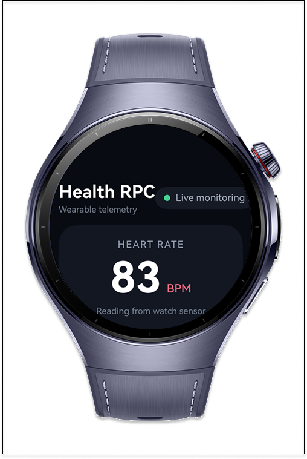
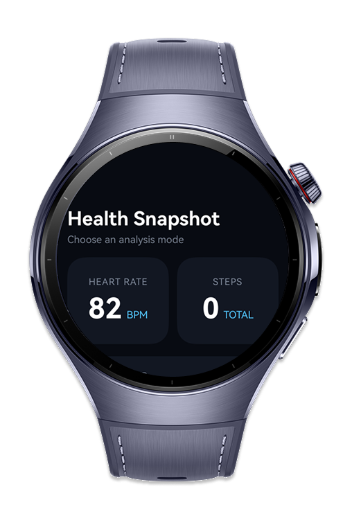
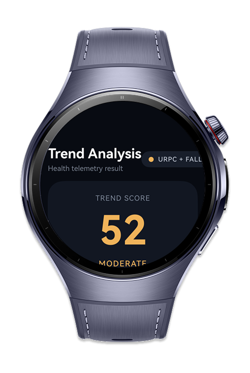

> **Note:** To access all shared projects, get information about environment setup, and view other guides, please visit [Explore-In-HMOS-Wearable Index](https://github.com/Explore-In-HMOS-Wearable/hmos-index).

# How to build URPC Health Reporter

URPC Health Reporter is a HarmonyOS wearable application that collects real-time health and activity data from the watch and demonstrates how this data can be transferred to a remote analytics service using URPC.

The application uses Sensor Service Kit to read the wearer’s current heart rate and step count. The collected measurements are combined into a timestamped health snapshot that can be reviewed before transmission.

For remote communication, the application uses URPC from Remote Communication Kit. It creates a URPC client stub, converts the health snapshot into Flowbuf-compatible request fields, and attempts to invoke the remote analyzeHealthSnapshot function through the EAT protocol.

The application also includes configurable server IP and port settings, request status tracking, connection error handling, call cancellation, and URPC resource cleanup.

Because a compatible URPC/EAT server is required for a successful remote response, the sample includes an explicitly labeled fallback mode. The fallback is used only after a real URPC connection attempt fails and generates a local demonstration result so that the complete application flow and result interface can still be tested.

The generated analysis is intended only to demonstrate data collection, URPC communication, navigation, and result visualization. It must not be interpreted as medical advice or a clinical health assessment.

# Preview

<div>
    
    
    
</div>

# Use Cases
- Remote Health Snapshot Analysis :
  The user collects a current heart rate measurement and step count from the watch. The application creates a health snapshot and sends it to a compatible URPC analytics service. The server processes the data and returns a trend score, analysis status, and recommendation.

- Low-Overhead Wearable Telemetry :
  The application demonstrates how compact, structured health data can be transmitted from a wearable device through URPC instead of using a conventional REST-based request flow. This can be useful for wearable scenarios where communication efficiency and reduced protocol overhead are important.

- Navigate Between Remote Folders :
  The cd command allows users to move between directories available on the connected FTP server.

- Fitness Activity Monitoring :
  A fitness application can periodically collect heart rate and step information and send the snapshots to a remote service for activity-level evaluation, historical comparison, or long-term trend processing.

- Health Data Collection for Research Prototypes :
  The sample can be adapted for research or proof-of-concept projects that collect timestamped wearable measurements and send them to a controlled analytics environment. Additional sensor values can be added to the URPC request contract when supported and authorized.

# Technology

## Stack
- **Languages**: ArkTS
- **Frameworks**: HarmonyOS SDK 5.1.0(18)
- **Tools**: DevEco Studio Version 6.0.1
- **Libraries**:
- @kit.ArkUI
- @kit.RemoteCommunicationKit
- @kit.BasicServicesKit
- @kit.PerformanceAnalysisKit
- @kit.SensorServiceKit

## Required Permissions

"ohos.permission.INTERNET"

# Directory Structure
```
│   module.json5
│
├───ets
│   ├───entryability
│   │       EntryAbility.ets
│   │
│   ├───entrybackupability
│   │       EntryBackupAbility.ets
│   │
│   ├───model
│   │       HealthSnapshot.ets
│   │       UrpcConfig.ets
│   │
│   ├───pages
│   │       HealthDashboardPage.ets
│   │       Index.ets
│   │       SendDataComponents.ets
│   │       SendDataPage.ets
│   │       ServerSettingsPage.ets
│   │       TrendAnalysisPage.ets
│   │
│   └───service
│           DemoHealthAnalysisService.ets
│           HealthSensorService.ets
│           UrpcClientService.ets
│
└───resources
    ├───base
    │   ├───element
    │   │       color.json
    │   │       float.json
    │   │       string.json
    │   │
    │   ├───media
    │   │       background.png
    │   │       foreground.png
    │   │       layered_image.json
    │   │       startIcon.png
    │   │
    │   └───profile
    │           backup_config.json
    │           main_pages.json
    │
    ├───dark
    │   └───element
    │           color.json
    │
    └───rawfile
```
# Constraints and Restrictions

## Supported Devices

- Huawei Watch 5

# License
**How to build URPC Health Reporter** is distributed under the terms of the MIT License
See the [license](./LICENSE) for more information.